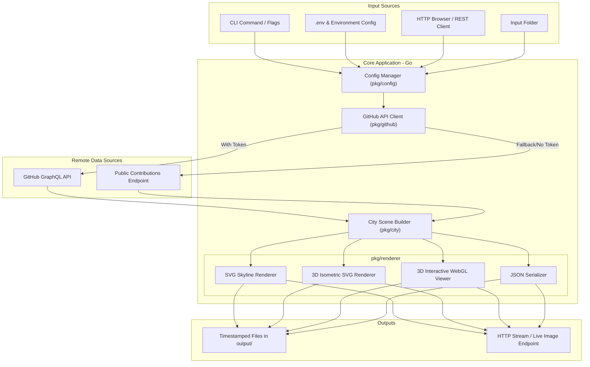

# Architecture and Workflow

This document details the system design, data transformation pipeline, mathematical scaling models, and architecture of **GitHub Contribution City**.

---

## 1. System Architecture Diagram



---

## 2. City Layout and Height Transformation Algorithm

Inspired by Markus Eisele's Quarkus Contribution City project:

### Logarithmic Building Height
To prevent single ultra-active weeks from completely flattening standard weeks, building height utilizes logarithmic scaling:

$$\text{height} = 1 + \text{round}\left( \frac{\ln(1 + \text{weeklyTotal})}{\ln(1 + \text{maxWeeklyTotal})} \times (\text{maxHeight} - 1) \right)$$

- When $\text{weeklyTotal} = 0$, $\text{height} = 1$ (representing ground floor / quiet week).
- When $\text{weeklyTotal} = \text{maxWeeklyTotal}$, $\text{height} = \text{maxHeight}$.

### 3D Facade & Window Patterns
Each building spans 7 calendar days (Sunday through Saturday). As building floors rise, windows cycle through the day levels ($0 \dots 4$) reflecting the week's daily activity rhythm.

### Landmarks & Antenna
The week with the highest contribution activity receives a broadcast antenna and beacon light at its peak, creating an identifiable skyline landmark.

---

## 3. Directory Layout

```
.
├── cmd/
│   └── city/
│       ├── main.go               # Application entrypoint (CLI & HTTP Server)
│       └── main_test.go          # End-to-end integration tests
├── pkg/
│   ├── city/
│   │   ├── city.go               # 2D Grid & 3D Isometric Scene Builder
│   │   └── city_test.go          # Unit tests for logarithmic transformations
│   ├── config/
│   │   ├── config.go             # Configuration loader (.env, env vars, defaults)
│   │   └── config_test.go        # Unit tests for config manager
│   ├── github/
│   │   ├── client.go             # GitHub GraphQL client & public HTML parser
│   │   └── client_test.go        # Unit tests for API parsers
│   └── renderer/
│       ├── html.go               # WebGL/Three.js interactive 3D HTML generator
│       ├── svg.go                # Standalone SVG Skyline & 3D Isometric generator
│       ├── theme.go              # Built-in visual themes (dark, light, cyberpunk, etc.)
│       ├── renderer_test.go      # Unit tests for renderers
│       └── renderer_bench_test.go# Performance benchmark tests
├── scripts/
│   ├── run.sh                    # Detached server launch script
│   ├── stop.sh                   # Graceful shutdown script
│   ├── cleanup.sh                # Project cleanup script
│   └── cleanup-containers.sh     # Container image cleanup script
├── Docs/
│   ├── Architecture.md           # Architecture and system documentation
│   └── Quickstart.md             # Getting started guide
├── input/                        # Batch input folder
├── output/                       # Generated timestamped output files
├── Containerfile                 # Podman multi-stage containerfile
├── Dockerfile                    # Docker multi-stage dockerfile
├── go.mod                        # Go module definition
├── README.md                     # Project overview and documentation
└── .env.example                  # Environment configuration template
```
