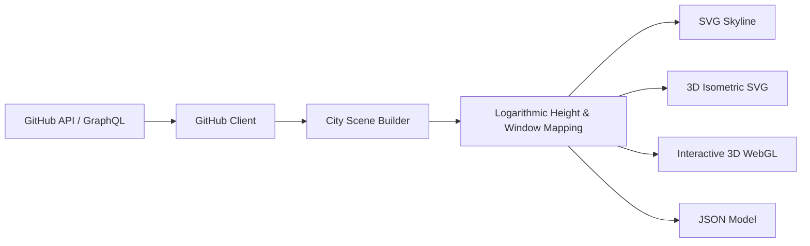

# 🏙️ GitHub Contribution City (Go)

[](https://golang.org)
[](https://opensource.org/licenses/Apache-2.0)
[]()

> A high-performance Go application that transforms GitHub user contribution calendars into 3D cities, isometric skylines, and interactive WebGL cityscapes. Inspired by the [Quarkus Contribution City](https://github.com/myfear/quarkus-contribution-city) project by Markus Eisele and featured on [DZone](https://dzone.com/articles/build-a-github-contribution-city-with-java-and-qua).

---

## 🌟 Overview

**GitHub Contribution City** maps software engineering activity onto urban architecture:
- **Each week** represents a building along the calendar street.
- **Weekly contribution totals** determine skyscraper heights using a smooth logarithmic curve.
- **Daily activity levels** (0–4) determine window patterns and neon illumination across facades.
- **Busiest week** features a broadcast antenna and beacon landmark at its peak.
- **Outputs**:
  1. **2D SVG Skyline**: Crisp vector skyline perfect for GitHub Profile READMEs.
  2. **3D Isometric SVG**: Isometric vector projection with realistic depth and lighting.
  3. **3D Interactive WebGL / Three.js**: Fully interactive 3D camera navigation, orbit controls, statistics overlay, and data inspection.
  4. **JSON API**: Programmatic data model representation for downstream toolchains.

---

## 🏗️ Architecture & Flow



Detailed architecture specifications and flow diagrams can be found in [`Docs/Architecture.md`](Docs/Architecture.md).

---

## 🎨 Built-in Visual Themes

- `github-dark`: GitHub Dark theme with emerald green activity levels (`#0d1117`, `#39d353`).
- `github-light`: Clean minimalist light mode.
- `cyberpunk`: Deep purple nights with cyan and neon pink lights.
- `neon`: Midnight blue skyline with vibrant cyan and magenta lights.
- `mono`: High-contrast grayscale skyline.
- `matrix`: Classic digital rain phosphor green glow.

---

## 🚀 Quick Start

### 1. Run via Automation Scripts

```bash
# Launch server in detached/background mode
./scripts/run.sh

# Stop server gracefully
./scripts/stop.sh

# Clean up build artifacts and temporary files
./scripts/cleanup.sh
```

### 2. Run CLI Directly

```bash
# Generate SVG Skyline
go run cmd/city/main.go -user torvalds -format svg -theme github-dark

# Generate 3D Isometric SVG
go run cmd/city/main.go -user torvalds -format iso -theme cyberpunk

# Generate All Formats (saved to output/)
go run cmd/city/main.go -user torvalds -format all
```

### 3. Embed in GitHub Profile README

Once published or served, embed your dynamic contribution skyline directly into your profile:

```markdown

```

---

## 🧪 Testing and Benchmarks

```bash
# Run all unit tests
go test -v ./...

# Run performance benchmarks
go test -bench=. ./...
```

---

## 🐳 Container Support

Multi-stage, minimal size `Containerfile` and `Dockerfile` (distroless/Alpine runtime ~15MB):

```bash
podman build -t github-contribution-city .
podman run -d -p 8088:8088 github-contribution-city
```

---

## 📄 Documentation

- [Quickstart Guide](Docs/Quickstart.md)
- [Architecture & Design](Docs/Architecture.md)

---

## 📜 License

Licensed under the **Apache License, Version 2.0**. See [LICENSE](https://www.apache.org/licenses/LICENSE-2.0) for details.
